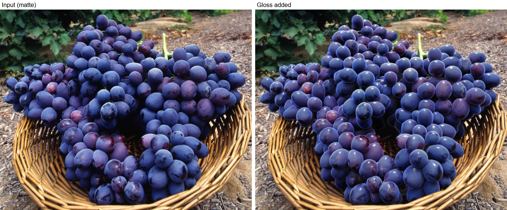

# gloss-perception-lab

Image-computable models of perceived gloss, tested against the human ratings of Serrano et al. (2021):

- **Cue models**: highlight cues (coverage, contrast, sharpness) and reflection cues, fed to a small regressor.
- **U-Nets** on RGB or on multi-scale centre-surround (LoG) responses.
- **Highlight maps learnt from privileged information**: a monocular U-Net trained on rendered scenes to predict the
  left-right stereo residual or the rendered specular share.

## Findings

| Topic | Result | Page |
|---|---|---|
| Predicting gloss ratings | Cue models and U-Nets reach about 95% of the noise ceiling within one shape (r 0.92 / 0.90, ceiling 0.94) and drop to r 0.64 / 0.63 on a held-out shape. Matte materials on finely detailed shapes are rated glossy by every model; metals are under-predicted because of reflections, not highlights. | [docs/RATING_MODELS.md](docs/RATING_MODELS.md) |
| Highlight maps from stereo or render supervision | A monocular U-Net trained to predict the left-right residual or the rendered specular share is calibrated on renders but transfers worse to Serrano images than simple cues (r 0.51 / 0.42). | [docs/STEREO_HIGHLIGHT.md](docs/STEREO_HIGHLIGHT.md) |
| Editing existing gloss | The gloss map finds compact highlights (AUC 0.87-0.95) but not the specular component as a whole (0.53-0.63), which is a reflection spread over the surface. Scaling a per-pixel specular share is the right edit; a highlight region with a layer is not. Networks trained on narrow synthetic data and a published highlight remover both fall short. | [docs/GLOSS_EDIT.md](docs/GLOSS_EDIT.md) |
| Adding gloss to a matte object | A specular layer from the normals and the lighting implied by the shading. Highlights alone look like paint; a sheen over the whole lit side makes them read as gloss. The amount of specular light predicted from the shading fit matches real renders. On photographs the sheen must keep the object's chromaticity. | [docs/GLOSS_SYNTHESIS.md](docs/GLOSS_SYNTHESIS.md) |
| Normals from one image | MoGe-2 gives 13 deg mean error on matte renders, against 24-28 deg for Marigold and silhouette inflation. The sheen survives estimated normals (r 0.8), the position of narrow highlights does not. | [docs/NORMALS.md](docs/NORMALS.md) |



Left: a public-domain photograph of grapes covered with bloom. Right: gloss added by `scripts/photo_gloss.py`.

## Setup

```powershell
python -m venv .venv
.\.venv\Scripts\python.exe -m pip install torch --index-url https://download.pytorch.org/whl/cu126
.\.venv\Scripts\python.exe -m pip install -r requirements.txt
```

Rendering scripts need Blender 4.5; `scripts/stereo_matching.py` needs `opencv-python`.
`normal_estimation` and `photo_gloss` also need `diffusers`, `transformers`, `huggingface_hub`,
`opencv-python-headless` and the MoGe repository (https://github.com/microsoft/MoGe) cloned into `external/MoGe`
with its `utils3d_moge` dependency; model weights are fetched from the Hugging Face hub on first use.

## Data

Serrano et al. (2021): 42,120 images (520 materials x 9 shapes x 9 illuminations) with median 1-7 ratings, from
https://mig.mpi-inf.mpg.de/. Put `Serrano_SIGG2021_PerceptualRatings.xlsx` in `data/serrano/`, then fetch images per
shape directly from the remote zip:

```powershell
.\.venv\Scripts\python.exe -I scripts\fetch_serrano_images.py --geometry sphere --size 256 --workers 8
.\.venv\Scripts\python.exe -I scripts\make_serrano_manifest.py --image-root data\serrano\images --out data\serrano\manifest_sphere.csv
```

`data/`, `runs/`, `external/` and PDFs in `docs/` are not tracked.

## Code

```
src/models/   U-Net (scalar or map head), LoG input features and gloss map P, TinyGlossNet
src/data/     manifest dataset with material-group split
src/train.py  training with rating-balanced sampling and material / illumination / shape hold-out
scripts/      cue extraction, evaluations, rendering and figures
```

```powershell
.\.venv\Scripts\python.exe -m src.train --dataset synthetic --epochs 5   # smoke test
.\.venv\Scripts\python.exe -m src.train --dataset manifest --manifest data\serrano\manifest_sphere.csv --root data\serrano\images --size 128
```

| Scripts | Purpose |
|---|---|
| `highlight_cues`, `reflection_cues` | cue extraction |
| `cue_model`, `cue_analysis`, `reflection_eval`, `rating_ceiling` | cue-model evaluation, error analysis, noise ceiling |
| `cue_illum_holdout`, `unet_illum_holdout` | material x illumination hold-out |
| `shape_masks`, `shape_holdout`, `shape_figures` | leave-one-shape-out |
| `stereo_render`, `stereo_residual`, `stereo_matching` | stereo-residual pilot (Blender) |
| `stereo_dataset`, `stereo_targets`, `train_highlight`, `serrano_highlight_eval` | training and evaluating highlight-map networks |
| `serrano_shape_render`, `serrano_render_eval`, `data_overview`, `false_highlight_figure` | diagnosis of the transfer failure |
| `merl_fit` | Principled BSDF fits of the MERL BRDFs |
| `gloss_edit`, `gloss_edit_eval`, `tshrnet_eval` | detectors and edits of existing gloss, scored against the true specular pass |
| `highlight_synthesis`, `photo_gloss` | specular layer for matte objects, on renders and on photographs |
| `normal_estimation` | normals from one image (silhouette inflation, MoGe-2, Marigold) |

Scripts that import `bpy` run inside Blender (`blender -b --factory-startup -P <script> -- <args>`). The others run as
`python -m scripts.<name>`.

## References

- Serrano, A., Chen, B., Wang, C., Piovarči, M., Seidel, H.-P., Didyk, P., Myszkowski, K. (2021). The effect of shape and
  illumination on material perception: model and applications. *ACM Transactions on Graphics*, 40(4), 1-16.
  doi:10.1145/3450626.3459813
- Marlow, P. J., Kim, J., Anderson, B. L. (2012). The perception and misperception of specular surface reflectance.
  *Current Biology*, 22(20), 1909-1913. doi:10.1016/j.cub.2012.08.009
- Kim, J., Marlow, P., Anderson, B. L. (2011). The perception of gloss depends on highlight congruence with surface
  shading. *Journal of Vision*, 11(9):4. doi:10.1167/11.9.4
- Prokott, K. E., Fleming, R. W. (2022). Identifying specular highlights: insights from deep learning. *Journal of
  Vision*, 22(7):6. doi:10.1167/jov.22.7.6
- Morimoto, T., Akbarinia, A., Storrs, K. R., Cheeseman, J. R., Smithson, H. E., Gegenfurtner, K. R., Fleming, R. W.
  (2026). Human gloss perception reproduced by tiny neural networks. *Nature Human Behaviour*, 10(7), 1340-1355.
  doi:10.1038/s41562-026-02445-0
- Fu, G., Zhang, Q., Zhu, L., Xiao, C., Li, P. (2023). Towards high-quality specular highlight removal by leveraging
  large-scale synthetic data. *ICCV 2023*, 12811-12819. doi:10.1109/ICCV51070.2023.01181
- Wang, R., Xu, S., Dong, Y., Deng, Y., Xiang, J., Lv, Z., Sun, G., Tong, X., Yang, J. (2025). MoGe-2: accurate
  monocular geometry with metric scale and sharp details. arXiv:2507.02546.
- Ke, B., Qu, K., Wang, T., Metzger, N., Huang, S., Li, B., Obukhov, A., Schindler, K. (2025). Marigold: affordable
  adaptation of diffusion-based image generators for image analysis. arXiv:2505.09358.
