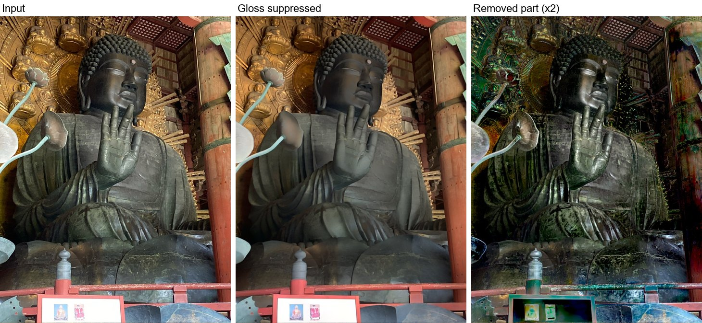
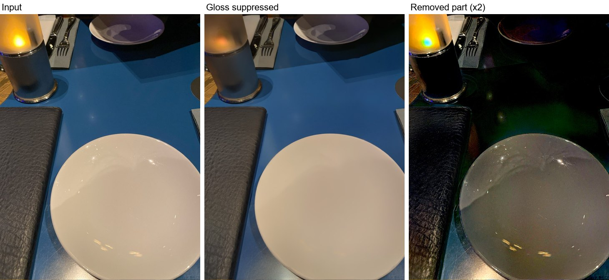
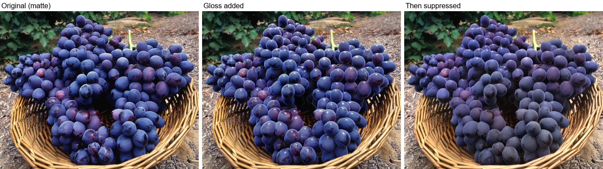

# Suppressing gloss: a shading fit for clean single objects, an intrinsic decomposition for photographs

Removing the specular part of a glossy object, and telling a matte object from a glossy one. Suppression is harder
than adding gloss ([GLOSS_SYNTHESIS.md](GLOSS_SYNTHESIS.md)): the specular light has overwritten the diffuse colour
under it, so what goes back in has to be estimated.

```powershell
.\.venv\Scripts\python.exe -m scripts.specular_separation               # renders, true normals -> runs/gloss_edit/separation.*
.\.venv\Scripts\python.exe -m scripts.specular_separation --estimated   # renders at 512 px, MoGe-2 normals
.\.venv\Scripts\python.exe -m scripts.photo_suppress --image photo.jpg --seed 0.58 0.60 --box 0.44 0.42 0.72 0.75 --out runs\photo\name
.\.venv\Scripts\python.exe -m scripts.intrinsic_eval                     # intrinsic decomposition on the renders
.\.venv\Scripts\python.exe -m scripts.intrinsic_eval photo1.jpg photo2.jpg   # ... and on photographs
```





Intrinsic decomposition (Careaga & Aksoy) on two photographs: input, suppressed image, and the removed part.

## Method 1: shading fit (no trained network apart from the normals)

Diffuse shading is a smooth function of the surface normal: nine spherical harmonics describe it well (Ramamoorthi &
Hanrahan 2001). The luminance of the object is fitted with these nine terms by iteratively reweighted least squares,
and what exceeds the fit is taken as specular.

- **Two-sided rejection**: pixels far from the fit on either side are down-weighted. Bright ones are specular light;
  dark ones are cast shadows and creases, which the harmonics cannot describe. Conservative: a matte object gives
  almost nothing.
- **One-sided rejection**: only pixels brighter than the fit are down-weighted, so the fit settles on the lower
  envelope. Removes more of a reflection, and takes relief shading for gloss on a matte object.
- **Judge, then edit**: the specular share of the object's light under the two-sided fit is the amount of gloss. Above
  0.02 the object is glossy and the one-sided estimate is removed; otherwise the image is left alone.
- **Silhouette band**: normals are unreliable on the contour, but that is where Fresnel reflection is strongest;
  leaving it out draws a white outline. The diffuse level of a 2 px band is taken from the suppressed interior.

## Method 2: intrinsic image decomposition

Careaga & Aksoy (2023, 2024) split a photograph into albedo × diffuse shading and a residual; the positive residual
holds specular reflections and light sources. The suppressed image is albedo × diffuse shading. It needs no object mask
and no normals. Their code and weights are for academic use only and are not part of this repository
(`scripts/intrinsic_model.py` says where to put them).

## Renders: the shading fit is more accurate

Error of the suppressed image against the true diffuse image (RMSE × 100, sRGB, object pixels), sets A (Serrano
geometries) and B (random scenes) of [GLOSS_EDIT.md](GLOSS_EDIT.md).

| | No edit | Shading fit, judge then edit | Intrinsic decomposition | Specular-share network | TSHRNet |
|---|---|---|---|---|---|
| A, glossy objects | 8.3–10.4 | 4.4–5.2 | 6.1–8.0 | 5.1–18 | 6.1–6.6 |
| A, matte objects | 0 | 0 | 2.8–6.8 | 0.3–19 | 7–12 |
| B, glossy objects | 11–12 | 7.1–8.6 | 9.2–9.5 | 6 | 11 |
| B, matte objects | 0 | 0.0–0.4 | 3.7–5.1 | 0.4–0.6 | 6–9 |

Matte against glossy, from the two-sided specular share:

| | Matte median | Glossy median | Judged glossy |
|---|---|---|---|
| A (48 images) | 0.003 | 0.089 | 0 of 24 matte, 24 of 24 glossy |
| B (300 images) | 0.002 | 0.085 | 2 of 73 matte, 180 of 227 glossy |

- With normals estimated by MoGe-2 instead of true normals the result is the same (12 matte and 12 semi-glossy
  renders at 512 px: error 4.4–5.4 against 4.2–5.7, all 24 judged correctly). Suppression takes the highlights from
  the image itself, so, unlike synthesis, it is not sensitive to a few degrees of normal error.
- A dichromatic colour separation (body colour + white) reached 3.2–4.7 on blue glossy renders, and destroyed matte
  objects (13–16) and scenes with varied materials (15–19): the body colour estimate breaks under coloured light.
- **A broad reflection is not removed.** It is itself a smooth function of the normal, so the fit absorbs part of it:
  the recovered specular share is 0.09–0.22 where the truth is 0.33. From one image this ambiguity is one of
  principle. It may matter little for appearance, since a broad smooth reflection without sharp features is also what
  shading looks like; this has not been tested with observers.
- The residual of the intrinsic decomposition does not measure gloss: it is about 0.10 of the light on matte renders
  as well (AUC 0.66 on A, 0.81 on B).

## Photographs: the shading fit breaks, the intrinsic decomposition holds

The shading fit assumes one smooth object of uniform albedo. On photographs, with the object picked by a seed point
and normals from MoGe-2:

- It removed the highlights of a green dumpling, a sausage, a mouse and a bronze head, with jagged region borders and
  blotches where surface colour varied.
- A white dumpling and a white plate, both with clear highlights, were judged matte (share 0.011 and 0.010): small
  highlights are a tiny share of the light of a bright body.
- Removed light must not be subtracted as white: under a coloured light that leaves a tint, and clipped pixels break.
  The gap takes the chromaticity of nearby body pixels instead.
- Matte grapes in a basket were judged glossy (share 0.054), and the one-sided fit would remove most of their light.
  Grapes shadow each other and differ in colour and bloom, so the lower envelope lies far below the lit surfaces.

The intrinsic decomposition removed the highlights across each whole photograph without a mask, including the white
objects, and without blotches.



A round trip: gloss added to the matte grapes ([GLOSS_SYNTHESIS.md](GLOSS_SYNTHESIS.md)), then suppressed. RMSE × 100
against the original photograph, over the grapes:

| Image | Difference from the original |
|---|---|
| Gloss added | 8.0 |
| then suppressed by the shading fit | 16.8 |
| then suppressed by the intrinsic decomposition | 9.1 |
| Original suppressed by the intrinsic decomposition | 5.5 |

The added highlights go, but the original does not come back. The sheen that synthesis adds is smooth in the normal
and stays, the two operations are not inverses of each other, and the decomposition also changes a matte input a
little (the grapes turn slightly grey).

## Which to use

| | Shading fit | Intrinsic decomposition |
|---|---|---|
| One clean object, uniform colour | better | usable |
| Real photographs | breaks on shadows, colour variation, several objects | works |
| Object mask | needed | not needed |
| Matte or glossy | reliable on renders, not on photographs | no |
| Matte input | left unchanged | changed a little |
| Time per image (Quadro M4000) | normals 3.3 s + fit | 5.3 s, 4.9 GB |

## Limits

- No perceptual ratings. Whether a suppressed image looks matte has been judged by nobody systematically.
- A matte or glossy judgement that works on photographs is still missing. The share of light is a poor measure for
  bright objects; highlight contrast and area relative to the body are the obvious next candidates.
- Photographs have no ground truth; only the grape round trip gives a number.
- The intrinsic decomposition is another group's model under an academic-use licence, trained on rendered indoor
  scenes; its behaviour on single objects against plain backgrounds has not been examined.
