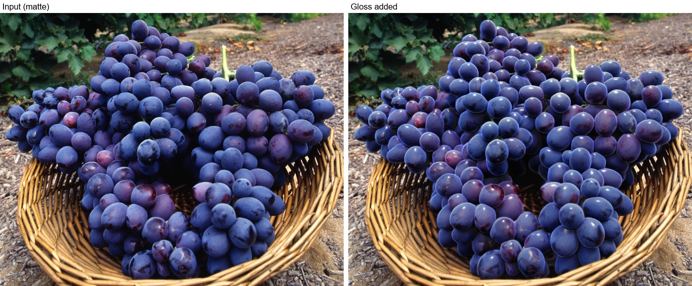

# Adding gloss to a matte object: a sheen over the lit side, then highlights

A specular layer for a matte object, computed from surface normals and from the object's own shading. Nothing of the
real surroundings is reflected.

```powershell
.\.venv\Scripts\python.exe -m scripts.highlight_synthesis      # renders with true normals -> runs/gloss_edit/synthesis.*
.\.venv\Scripts\python.exe -m scripts.photo_gloss --image photo.jpg --crop x0 y0 x1 y1 --hue 0.58 0.85 --out runs\photo\name
```



Left: a public-domain photograph of grapes covered with bloom. Right: output of `photo_gloss` (roughness 0.3).

## The layer

1. **Lighting from the shading.** Fit the luminance of the object with Y ≈ n·L + b over its pixels (n: unit normal).
   For a Lambertian surface of albedo ρ this is the reflection of lighting a₀ + a₁ (ω·l): a₀ = b / ρ is uniform,
   a₁ = 1.5 |L| / ρ grows towards the direction l of L.
2. **Light direction.** The fit and the prior that light tends to come from above are combined as von Mises–Fisher
   distributions: the mean direction is κ_fit · l + κ_prior · up, with κ_fit = 10 R² / (1 − R²). A clear shading
   gradient overrides the prior; an ambiguous one falls back on it.
3. **Wide part.** A smooth surface mirrors the lighting: F(n·v) · max(0, a₀ + a₁ (r·l)), with r the mirror direction of
   the view and F Schlick's Fresnel reflectance (0.04 at normal incidence).
4. **Narrow part.** A share of the directional light is taken to come from one compact source, reflected through a GGX
   lobe; its roughness sets the sharpness of the highlight.
5. **Occlusion.** Both parts are reduced where the shading is dark (creases).

Two values do not follow from the image: the albedo ρ, which sets the strength, and the share of the compact source
(0.5).

## Findings

- **Highlights alone look like paint.** If only bright spots are added, the rest of the surface keeps its matte
  luminance. A strong light is implied but the surface does not respond to it, and the spots read as a pattern on a
  matte surface. With a sheen over the whole lit side, which also accentuates the shading, the surface reads as smooth
  and the spots as highlights. This was judged by eye on four shapes, by one observer.
- **The same shows in the cues.** In real glossy renders the highlight region covers 1.6–5.6% of the object *and* is
  6–69 times brighter than the body, and the specular part is 0.29–0.40 of the object's light. A point light gives
  either coverage (rough lobe, 3–6 times the body) or contrast (sharp lobe, 0.2–0.3% coverage), and a specular share of
  0.04–0.07.
- **A uniform bright highlight looks like a sticker.** Highlights must be graded with surface orientation.
- **An assumed bright sky** (upper hemisphere bright, whatever the shading says) draws a horizon band on smooth shapes.
  The wide part has to come from the same fitted light.
- **The fitted lighting predicts the amount of specular light.** With the true albedo, the specular share of the layer
  follows the real semi-glossy renders across shapes and illuminations:

  | Shape | Ours (three lights) | Real renders |
  |---|---|---|
  | sphere | 0.51, 0.53, 0.23 | 0.47, 0.46, 0.23 |
  | bunny | 0.37, 0.41, 0.23 | 0.40, 0.38, 0.21 |
  | Buddha | 0.42, 0.44, 0.23 | 0.32, 0.33, 0.22 |
  | dragon | 0.39, 0.37, 0.26 | 0.34, 0.32, 0.23 |

- **Congruence with the shading** (Kim, Marlow & Anderson 2011) holds by construction: layer and shading come from the
  same normals and the same light, so highlights sit near the bright shading and follow the same surface curvature.

## Compositing on photographs

- Adding the whole layer as white light makes the object brighter and paler.
- Darkening the diffuse part to compensate, with a white layer, changes the colour: the grapes looked like a different
  variety.
- **Reference:** the wide part changes luminance only, so every pixel keeps its chromaticity; only the narrow highlight
  is added as white; the diffuse part is scaled, again without changing chromaticity, so that the object's mean
  luminance stays the same. A coloured sheen is not what a dielectric does physically; it is what keeps the object's
  identity.

## Limits

- No perceptual ratings yet. The statements about appearance rest on one observer.
- The albedo is a guess for photographs (0.1 for the grapes).
- A shading fit assumes uniform albedo and ignores cast shadows and interreflections (R² 0.97–0.99 on the sphere,
  0.5–0.7 on the Buddha and the dragon, 0.44 on the grapes).
- One light and low-order lighting: no structure inside the reflection, which smooth large surfaces need.
- Positions of narrow highlights do not survive estimated normals ([NORMALS.md](NORMALS.md)).
- Video has not been tried; per-frame normals would make highlights flicker.
